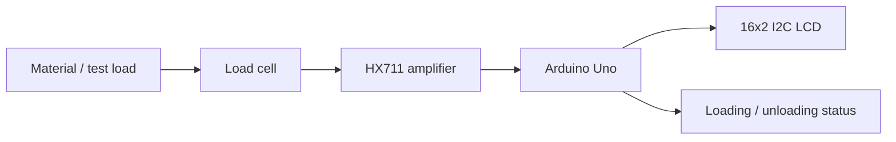

# IoT-Based Smart Railway Wagon Loading and Unloading Monitoring System

**Arduino Uno | Load Cell | HX711 | 16x2 I2C LCD**

## Overview
This academic project monitors material loading and unloading using a load cell, HX711 amplifier, Arduino Uno, and LCD. The controller reads the load measurement and displays it. Changes in measured weight can indicate loading (increase) or unloading (decrease).

> **Scope:** This starter package documents load monitoring. It does not assume an automated conveyor, crane, wagon gate, or unloading actuator unless you confirm that you built one.

## Problem statement
Manual estimation of wagon load can be inaccurate. A monitoring prototype can display measured load and compare it with a configured target to support loading checks.

## Objectives
- Measure applied load using a load cell.
- Interface the load cell through an HX711 module.
- Display the measured load on a 16x2 I2C LCD.
- Compare the reading with a configurable target.
- Demonstrate loading and unloading through changes in measured weight.

## Components
| Component | Purpose |
|---|---|
| Arduino Uno | Main controller |
| Load cell | Measures applied load |
| HX711 | Amplifies and digitizes load-cell signal |
| 16x2 I2C LCD | Displays reading and status |
| Platform, wires, power supply | Prototype assembly |

Record the actual load-cell model, rated capacity, and other specifications from your hardware.

## Software
- Arduino IDE
- HX711 library (for example, Bogde HX711)
- Compatible LiquidCrystal_I2C library
- Embedded C/C++

## Block diagram

## Working principle
1. Material is placed on the load-cell platform.
2. The load cell produces a small signal proportional to applied force.
3. HX711 amplifies and digitizes the signal.
4. Arduino converts the reading using a calibration factor.
5. The LCD displays the measured load.
6. The controller compares the reading with a configured target.
7. Increasing readings indicate loading; decreasing readings indicate unloading.

## Example pin assignment — verify your actual circuit
| Module signal | Arduino Uno |
|---|---|
| HX711 DT/DOUT | D3 |
| HX711 SCK/CLK | D2 |
| LCD SDA | A4 |
| LCD SCL | A5 |
| Common ground | GND |

Follow the exact module datasheets for supply voltage and load-cell wiring. Load-cell wire colours are not universal.

## Firmware
See `Code/Train_Loading_Unloading.ino`. The calibration factor, target load, tolerance, and LCD address are placeholders. Replace them using your actual hardware calibration and project specifications.

## My contribution
Update to accurately reflect your work:
- Load-cell and HX711 interfacing
- Arduino programming
- LCD integration
- Loading/unloading monitoring logic
- Hardware testing and documentation

## Results
Record actual calibration details and test readings in `Results/RESULTS-TEMPLATE.md`. Do not invent measurements or accuracy claims.

## Limitations
- Readings depend on calibration and mechanical mounting.
- Vibration and movement can affect measurements.
- A small prototype does not establish the safe capacity of a real railway wagon.
- No automatic loading/unloading mechanism is included in this starter package.

## Future improvements
- Wireless data logging, if implemented
- Overload warning indicators, if implemented
- Improved mechanical mounting and vibration filtering
- Validation against certified reference weights

## Author
Kathir Kamalesh N

## Disclaimer
This is an educational prototype, not a certified railway weighing system. Do not use it for operational railway loading decisions.
